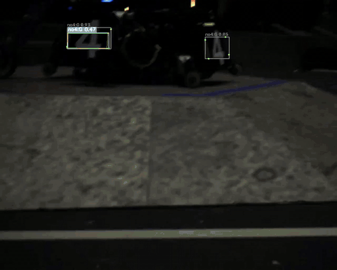
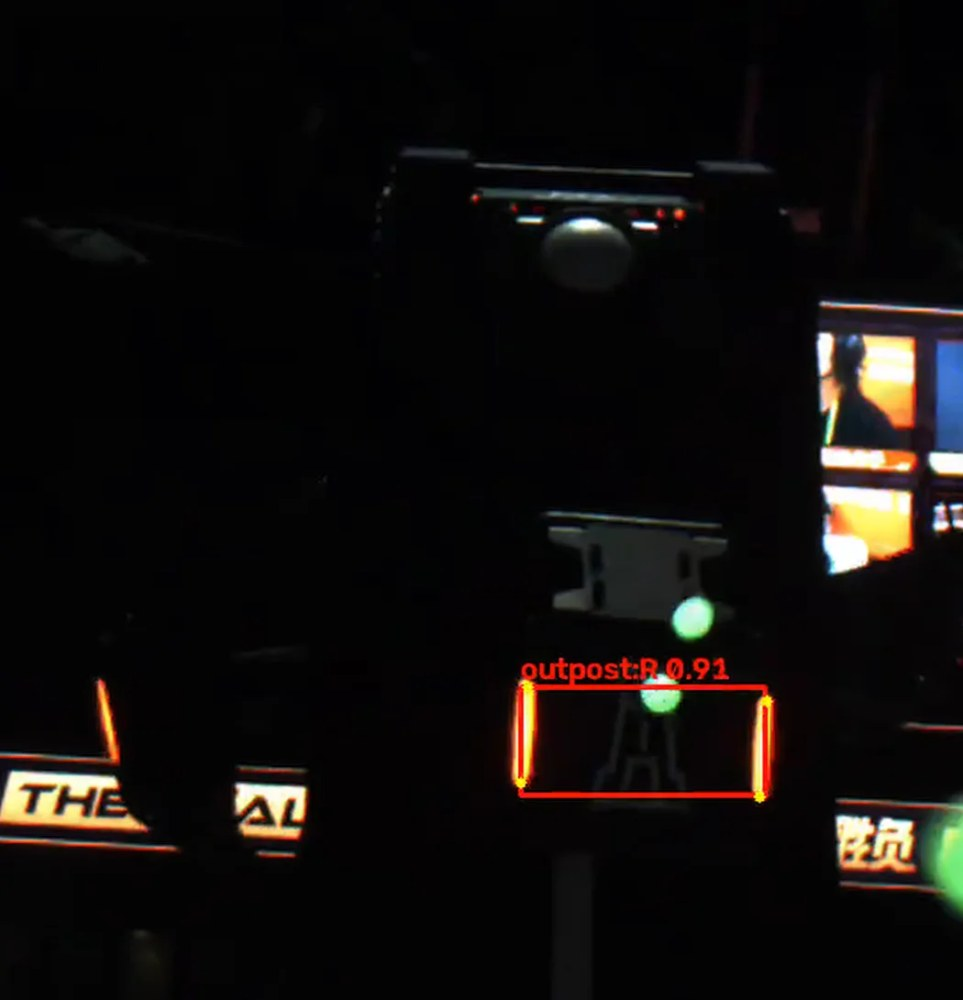
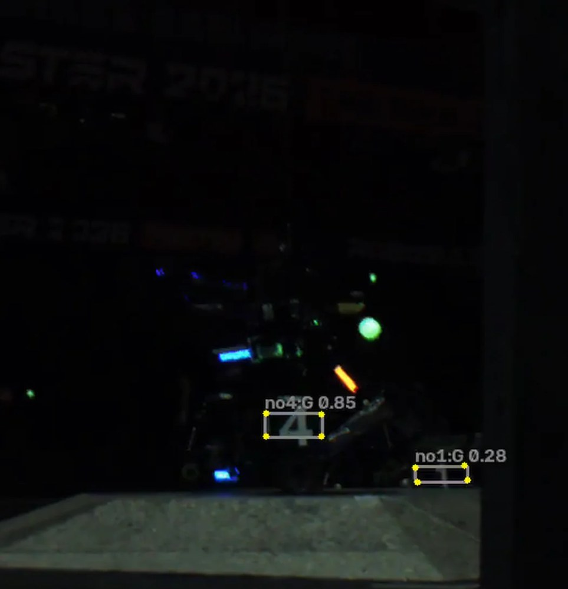
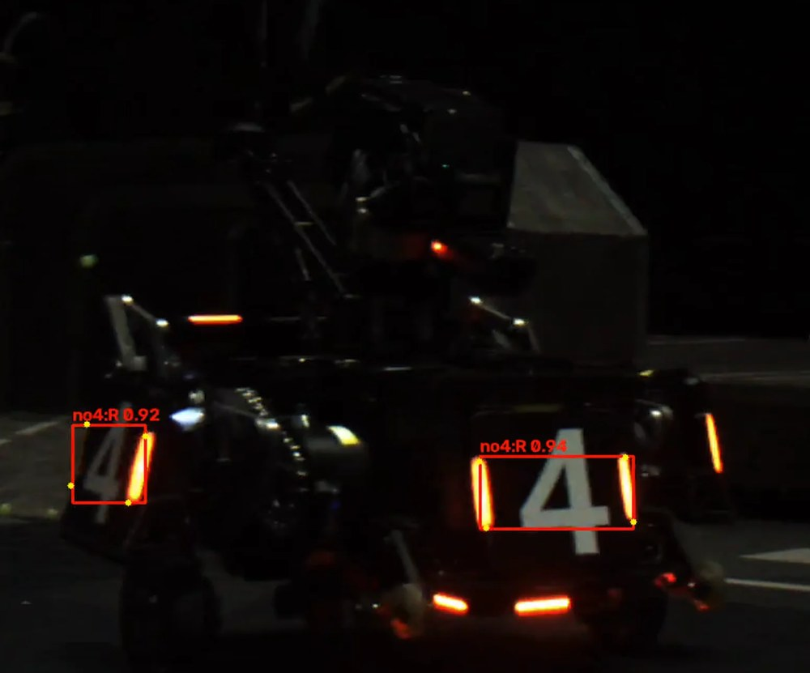
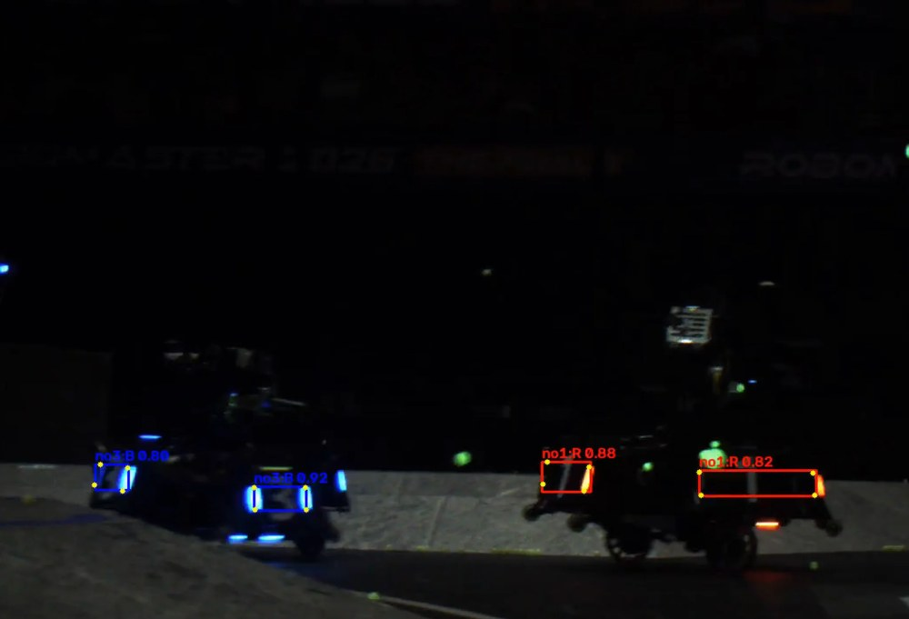

# armor-ulm 训练框架和权重

RoboMaster 装甲板检测 + 四角点：一次前向输出 **框 + 车辆类别(7) + 颜色(红/蓝/灰) + 四角点(4×3)**。

基于 Ultralytics YOLO26 + [YOLO-ULM (CVPR 2026)](https://openaccess.thecvf.com/content/CVPR2026/html/Han_YOLO-ULM_Ultra-Lightweight_Models_for_Real-Time_Object_Detection_CVPR_2026_paper.html) 的 `D3C2f` / `RepDown`。**AGPL-3.0。**

## 输入输出

**输入**：`1×3×H×W`，RGB，`/255`，letterbox 灰边(114)。`.pt` 用 ultralytics 自动处理；
`.onnx` 为动态 H/W（fp32, opset 17）。

**输出**：`(B, 26, A)`，`A = 8400`(640) / `3549`(416)

| 通道 | 含义 | 说明 |
|---|---|---|
| `0:4` | cx cy w h | 已解码，输入图像素，不要再做 DFL |
| `4:11` | 7 车辆类概率 | 已 sigmoid |
| `11:23` | 4 × (x, y, v) | 已解码，`v` 已 sigmoid |
| `23:26` | 3 颜色 | **`.pt` = sigmoid 值，`.onnx` = 原始 logits** |

完整：[`docs/output-decode.md`](docs/output-decode.md)。

**标签**：`颜色id 车辆id cx cy w h + 4×(x,y,v)`
详见 [`docs/dataset-format.md`](docs/dataset-format.md)

## 演示

`orphie_27-35min.mp4` 的 7:35–7:40 ：
[标注版 mp4](examples/demo/orphie_7m35s-7m40s_det.mp4)（1280×1024，143 帧 / 5 s）。

 
 

红框红方 / 蓝框蓝方 / 灰框灰甲 / 黄线四角点。

## 许可与参考

- 代码与权重：AGPL-3.0.
- 论文：YOLO-ULM, Han et al., CVPR 2026 —— `D3Block/D3C2f/RepDown/FoCIoU` 按论文 3.1–3.3 节**独立实现**.
- 标注思路参考**深圳大学 RobotPilots 战队**
  【RM2026-视觉模型统一部署库与识别模型开源】<https://bbs.robomaster.com/article/1942761>.本项目使用了该战队开源的权重进行了部分数据标注，特别感谢深圳大学 RobotPilots 战队的开源方案和权重。
- 同时感谢河北科技大学 Actor&Thinker 战队等开源方案的战队.
- 本项目使用了上述开源的权重进行对比，对比结果不进行公开，再次感谢开源的战队。